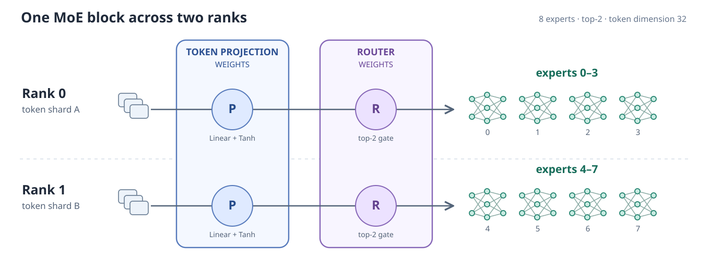
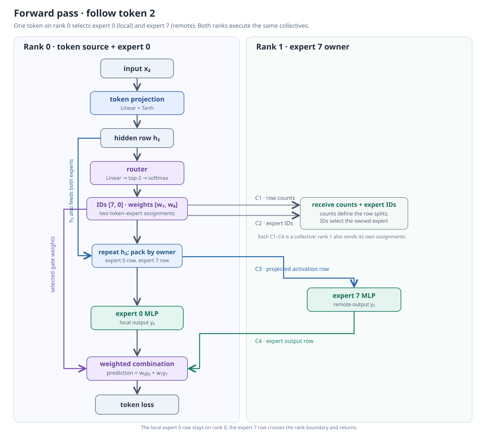
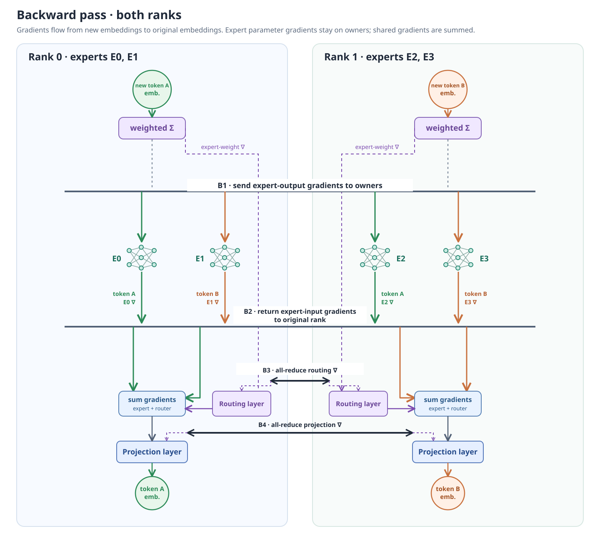
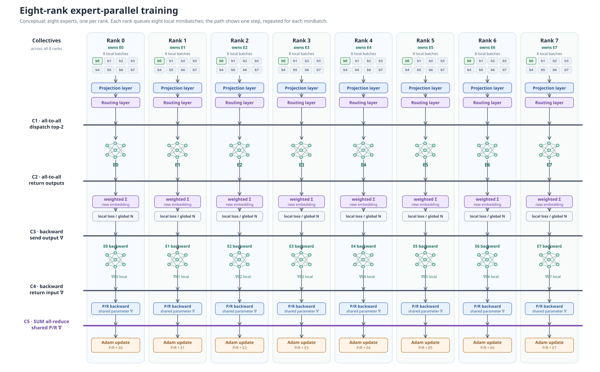

# Expert-parallel MoE


## Approach

### Model architecture: two ranks

The default model we use has one MoE block, token dimension 32, eight experts, and top-2 routing. In this two-rank example, each rank gets different input tokens. Each has its own copy of the **same** token-projection (32 x 32) and router weights, while the eight expert MLPs are split and owned by different ranks.



The  projection layer and router weights are replicated exactly across the ranks since every token needs to go through these. Each GPU rank (process in CPU case) contains a subset of the expert MLPs. The projection layer is `Linear(32, 32) + Tanh`, the router is `Linear(32, 8)`, and each expert is `Linear(32, H) + Tanh + Linear(H, 32)`. In this example, the router selects two expert IDs per token and softmax-normalizes their two selected logits into weights. The 2 selected experts' outputs are averaged, weighted by the router's weights. We can stack multiple of these MoE blocks together. `StandardMoEBlock` owns all eight experts on one rank and is the single-rank implementation. `ParallelMoEBlock` is the implementation with communication such that the MoE block can perform forward passes with the experts split across ranks for an arbitrary nummber of ranks.

### Forward pass: dispatch, compute, return

This four-expert example shows both ranks at once. Rank 0 owns Expert 0 and Expert 1 and rank 1 owns Expert 2 and Expert 3. Token A starts on rank 0 and the router selects E0 (local) plus  E2 (rank 1). Token B starts on rank 1 and the router selects  E3 (local) plus E1 (rank 0). 



The horizontal lines mark cross-rank communication. **C1** and **C2** use `dist.all_to_all_single` to exchange the number of tokens it has for each rank (by expert) and the expert IDs for each of the tokens for each rank. At **C3**, the expert inputs are dispatched to the correct rank where the expert lives also using All-to-All. At **C4**, expert outputs return to their original ranks, the green arrows carry E0 and E2 outputs back to A on rank 0, and orange arrows carry E1 and E3 outputs back to B on rank 1. Both activation exchanges use autograd-aware `all_to_all_single`. The return uses inverse split sizes; each source rank undoes its packing permutation, restores token/slot order, and combines the two expert outputs with its expert weights (the router's normalized top-k probabilities). The weighted Σ produces a new token embedding, which can feed the next block. 

### Backward pass: reverse the activation exchanges

Each source rank computes its **summed token loss divided by the global token count** `N`. The local losses across ranks add up to the global mean loss:

```text
L_r = (1/N) · Σ_{tokens i on rank r} mean_j (prediction_ij - target_ij)²
L_global = L_0 + L_1
```

The diagram starts with the gradient arriving at each outputted token embedding. On both ranks, it passes through the weighted combination into the local expert output, the remote expert output, and the expert weights. Each remote expert-output gradient goes to its owner. The experts accumulate parameter gradients on their owner ranks, then send expert-input gradients back to the ranks that own the token. Each rank adds its local expert, remote expert, and router gradients before backpropagating through its token projection layer to the original token embedding. Each rank's expert MLP gradients are computed only from the tokens that were routed to the rank. The rest of the weights, like the router and projection layer's gradients, are computed across the tokens in batches across all the ranks.



In the backward figure, **C1** and **C2** are the backward calls of the two autograd-aware activation exchanges. The `∇` labels beneath the experts identify each token's gradient with respect to that expert's input; C2 returns those gradients to the source ranks. **C3** and **C4** show the routing and projection parameter-gradient all-reduces. The code calls `dist.all_reduce(SUM)` once per replicated parameter. We **do not divide by rank count again**: each local loss already uses the global `N`. Expert parameter gradients accumulate on their owner from every source rank and are **not all-reduced**. Gradients reach selected router logits through the expert combination weights. 

### Eight-rank training view

The same flow extends across eight+ ranks. In this conceptual view, each rank owns one of eight experts and has eight minibatches local to each rank. The diagram follows one minibatch per rank through a complete training step, the step repeats for the remaining minibatches.




## Reproduce

Use Python 3.13. The recorded environment was ARM64 macOS with PyTorch 2.9.1; pins are in `requirements.txt`.

```sh
python3 -m venv .venv
. .venv/bin/activate
pip install -r requirements.txt
python experiments/correctness.py && python experiments/scaling.py
```

`experiments/correctness.py` prints named pass/fail checks and saves a loss plot and [short results report](results/correctness/README.md). `experiments/scaling.py` runs the timing jobs and saves scaling figures and a [short results report](results/scaling/README.md). Both launch experiments only through `run.py`. You can also run one job directly:

```sh
python run.py --ranks 2 --tokens 65 --epochs 30 --lr 0.001 --blocks 1
python run.py --ranks 4 --tokens 1024 --epochs 25 --warmup 5
python run.py --ranks 8 --tokens 16384 --experts 16 --expert-hidden 1024 --epochs 25 --warmup 5
```

`--tokens` is always the **total** batch size; `torch.tensor_split` divides it as evenly as possible. The target is deterministic regression to `0.3*tanh(x)+0.2`. Each epoch reuses that batch. Every run uses learned routing and Adam with its default betas and no weight decay. The default learning rate is 0.001.
`--expert-hidden` sets the hidden width of each expert MLP; its default is 64.
`--experts` sets the global expert count; its default is 8 and it must be divisible by the rank count.

## Read the code

1. `moe/model.py`: `MoEModel` builds `StandardMoEBlock` or `ParallelMoEBlock` instances. `ModelConfig.num_blocks` controls the stack depth. The parallel block uses PyTorch's autograd-aware variable-size all-to-all for activations.
2. `moe/training.py`: the training step, step reporting, shared-gradient synchronization, and one training loop that calls `model(x)` in either mode.
3. `run.py`: one generic worker that initializes the model and data shard. It seeds layers by global block and expert ID so standard and parallel runs start from the same model; the two files in `experiments/` launch it with different configurations.

## Correctness runs

`experiments/correctness.py` launches one-block jobs with **65 total tokens** at 1, 2, and 4 ranks. One-epoch jobs check one-step outputs, input gradients, every owned/shared parameter gradient and post-step value. They also check that the projection, router, and all eight routed experts get nonzero gradients and change after the step. Thirty-epoch jobs compare global loss at every epoch and final parameters. The one-rank job builds `MoEModel(parallel=False)`; the others build `MoEModel(parallel=True)`. Numerical comparisons use float64, `atol=1e-8`, and `rtol=1e-6`.

It also launches a short **two-block** job with 17 total tokens and two epochs at 1, 2, and 4 ranks to check that stacked blocks preserve those equivalences. `--capture-state` includes full tensors in each run's JSON output; the correctness script keeps those large comparison files in a temporary directory. It does not execute a reference model inside parallel workers. Compact checks, parameter-update evidence, a two-token trace, and [the loss plot](results/correctness/loss.svg) are saved in `results/correctness`. Each worker initializes its model and data shard, trains, and records its result.

The 65-token one-step fixture reaches and updates all eight experts. The implementation keeps empty expert calls in the autograd graph and has every rank participate in the same collectives, but the submitted suite does not force a rank to receive zero assignments.

## Scaling runs

`experiments/scaling.py` measures five one-block workloads. The first two use eight experts: hidden width 64 with 256–1,024 total tokens across 1, 2, and 4 ranks, and width 512 with 1,024–8,192 tokens across 1, 2, 4, and 8 ranks. The next three use 16 experts with hidden widths 1,024, 2,048, and 4,096, crossing 2,048, 4,096, 8,192, and 16,384 tokens with 1, 2, 4, and 8 ranks. A final comparison uses two blocks at 16,384 tokens with the width-1,024 model. These grids show how rank and batch-size trends change as expert computation grows, while the separate block comparison tests the cost of adding depth. Each job runs 25 epochs, with 5 warmup epochs and 20 measured epochs. PyTorch intra-op computation uses one thread per worker; a barrier precedes timing, and an all-reduced maximum makes the slowest rank define step latency. Startup, result serialization, and correctness comparisons are excluded.

Scaling logs contain per-rank parameter bytes and per-epoch loss, latency, expert assignments, and remote assignment counts. `experiments/scaling.py` derives load imbalance, token throughput, logical payload, and an estimate of Adam state storage from the model parameters. The report shows the [batch-size crossover](results/scaling/batch-crossover.svg), [rank speedup by expert width](results/scaling/rank-speedup-by-width.svg), [model and optimizer storage per rank](results/scaling/parameter-storage.svg), and [fixed-local throughput](results/scaling/fixed-local-throughput.svg); the other sweeps are supporting views. For `R` remote assignments, dimension `d`, element size `b`, and `W` ranks, each forward or backward activation phase moves `2Rdb` bytes across the cluster; routing IDs and count exchange add `8R + 8W(W-1)` metadata bytes per block. These are logical tensor payloads, not measured physical network traffic. The storage plot excludes gradients, activations, and process memory. The run does not measure all-reduce network traffic.

See the [correctness report](results/correctness/README.md) and [scaling report](results/scaling/README.md) for the measured results and their limits. This small single-host CPU experiment does not establish a GPU speedup.
