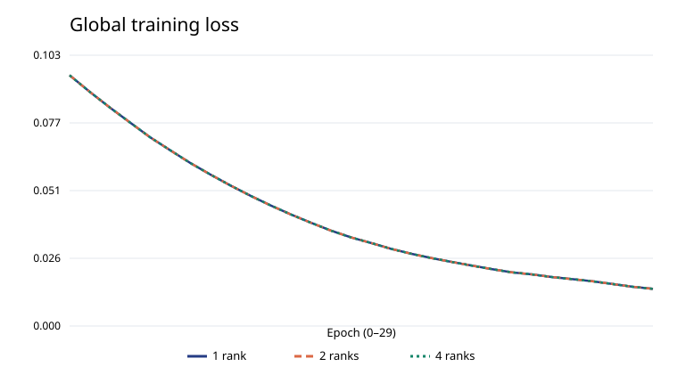

# Correctness Results

Does our multi-rank expert-parallel training compute the same:

- outputs
- gradients
- Adam updates

as single-rank naive MoE training?

We ran deterministic experiments with the same training dataset and weight initializations, comparing one-rank training using `StandardMoEBlock` (no communication code; meant to run on a single device) with 2- and 4-rank training using `ParallelMoEBlock`, which uses expert parallelism. We also keep the learning hyperparams the same in this comparison.

## One-step equivalence

Each row compares a multi-rank `ParallelMoEBlock` run with a one-rank `StandardMoEBlock` run and these use one MoE block, 65 total tokens, and one optimizer step. They track the maximum difference in output, gradients, and updates over every token or owned parameter:

| # of ranks | Output | Token/Input gradient | Parameter gradient | Parameter after Adam |
|---:|---:|---:|---:|---:|
| 2 | 0 | 0 | 8.67e-19 | 5.55e-17 |
| 4 | 0 | 0 | 1.08e-18 | 3.47e-17 |

## Multi-step equivalence

| Blocks | Total tokens | Epochs | # of ranks | Max loss difference | Max final-parameter difference |
|---:|---:|---:|---:|---:|---:|
| 1 | 65 | 30 | 2 | 2.78e-17 | 1.56e-16 |
| 1 | 65 | 30 | 4 | 2.08e-17 | 1.39e-16 |
| 2 | 17 | 2 | 2 | 1.39e-17 | 9.71e-17 |
| 2 | 17 | 2 | 4 | 1.39e-17 | 2.62e-15 |

## Did the parameters actually update?

The 4-rank, single-step training run routed assignments to every expert. The number of tokens routed to each expert is 12, 5, 19, 9, 5, 35, 26, 19. The table reports the **smallest**, across a group's parameter tensors (and across replicas where applicable), of each tensor's largest absolute gradient. A positive value means every tensor in that group received a nonzero gradient. The correctness check also verifies that every tensor changed after Adam.

| Parameter group | Owner rank | Assignments | Smallest gradient |
|---|---:|---:|---:|
| token_projection | replicated | — | 0.00248 |
| router | replicated | — | 0.000871 |
| experts.0 | 0 | 12 | 0.000735 |
| experts.1 | 0 | 5 | 0.000439 |
| experts.2 | 1 | 19 | 0.000852 |
| experts.3 | 1 | 9 | 0.000346 |
| experts.4 | 2 | 5 | 0.000382 |
| experts.5 | 2 | 35 | 0.00161 |
| experts.6 | 3 | 26 | 0.000791 |
| experts.7 | 3 | 19 | 0.000776 |

The router and token projection layers are replicated across ranks, so their gradients are SUM all-reduced across ranks before Adam. Whereas, each expert layer has a single rank that computes and stores its gradients.

## Training trajectory

The global loss fell from **0.095015** to **0.014079** in 30 epochs. The 1-, 2-, and 4-rank curves overlap:

