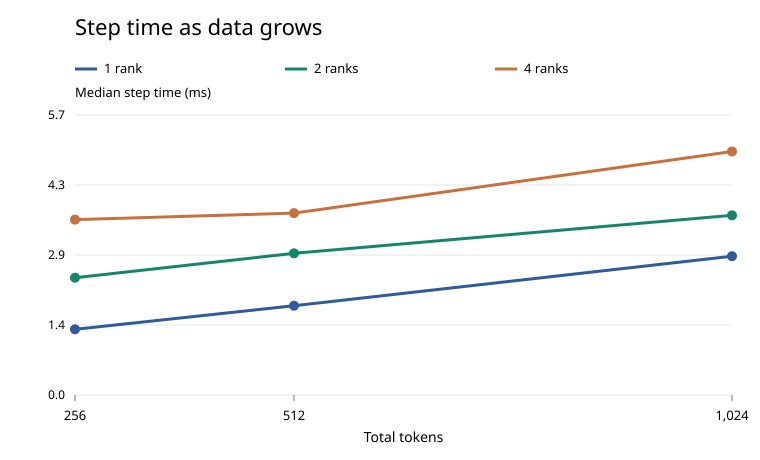
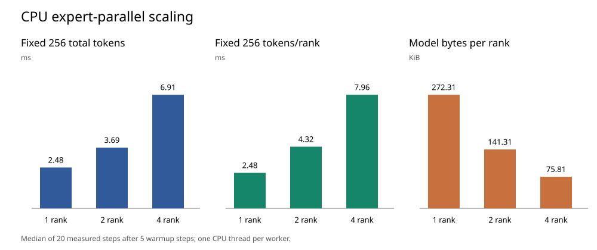
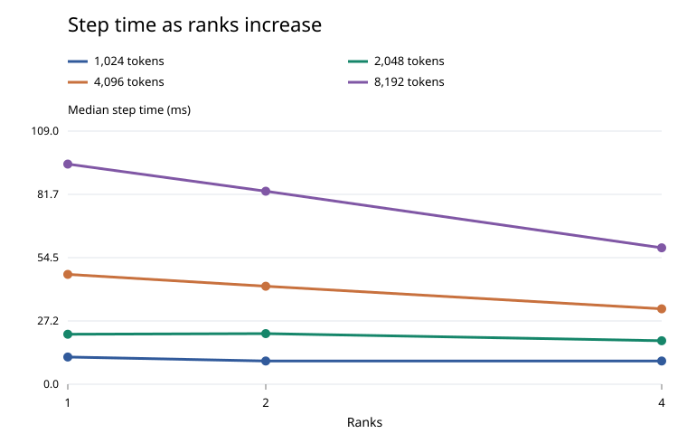
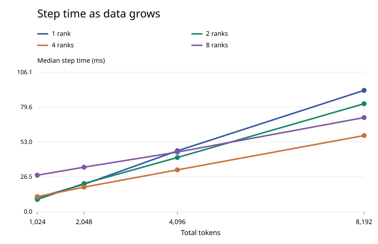

# CPU scaling results

## Question and method

How do rank count, parameter storage, communication, and step time change when an eight-expert MoE is split across ranks? These one-block CPU/Gloo jobs use float64, learned top-2 routing, Adam at learning rate 0.001, and one CPU thread per worker. Each job ran 25 steps: 5 warmup and 20 measured. A barrier starts each timed step, and its duration is the slowest rank's time. Startup, logging, and correctness comparisons are outside the timed step.

We run two model sizes. The small expert has hidden width **64** and uses 256, 512, and 1,024 total tokens. The larger expert has hidden width **512** and uses 1,024, 2,048, 4,096, and 8,192 tokens. Each token count is crossed with **1, 2, and 4 ranks**. Expert count (8), top-2 routing, and token dimension (32) stay fixed. This makes the larger model's expert computation heavier without enlarging the communicated activation row.

## Small expert: communication dominates

| Ranks | Total tokens | Tokens/rank | Model KiB/rank | Median ms | p95 ms | Tokens/s at median | Expert imbalance |
|---:|---:|---:|---:|---:|---:|---:|---:|
| 1 | 256 | 256 | 272.3 | 1.333 | 1.361 | 192,054 | 1.36 |
| 2 | 256 | 128 | 141.3 | 2.478 | 2.552 | 103,326 | 1.36 |
| 4 | 256 | 64 | 75.8 | 3.623 | 5.413 | 70,668 | 1.36 |
| 1 | 512 | 512 | 272.3 | 1.841 | 1.959 | 278,044 | 1.45 |
| 2 | 512 | 256 | 141.3 | 2.877 | 3.002 | 177,984 | 1.45 |
| 4 | 512 | 128 | 75.8 | 5.527 | 6.304 | 92,637 | 1.45 |
| 1 | 1,024 | 1,024 | 272.3 | 2.873 | 3.116 | 356,450 | 1.49 |
| 2 | 1,024 | 512 | 141.3 | 3.723 | 3.945 | 275,047 | 1.49 |
| 4 | 1,024 | 256 | 75.8 | 4.624 | 5.316 | 221,444 | 1.49 |

For fixed total work, model storage falls from **272.3 to 75.8 KiB per rank**, while median step time rises from **1.333 to 3.623 ms**. Expert weights are sharded; the shared projection and router still occupy 10.3 KiB on every rank. This small CPU workload pays more for communication and coordination than it gains from dividing expert computation.

For fixed local work, total throughput is **192,054, 177,984, and 221,444 tokens/s** at 1, 2, and 4 ranks. Median step time grows from **1.333 to 4.624 ms**. This describes larger total work, not a fixed-batch speedup.

### Trends by rank and data size

Each point is a separate run's median step time. Lines in the first graph hold total tokens constant while ranks change; lines in the second hold ranks constant while total tokens change.

The original bar chart gives a compact view of the 256-token fixed-total comparison, the 256-tokens-per-rank diagonal, and parameter storage:

## Larger expert: more compute per exchanged token

With hidden width 512, the following table shows median step latency for the same global token count across ranks. The last column is `1-rank time / 4-rank time`; values above 1 indicate a measured speedup.

| Total tokens | 1 rank ms | 2 ranks ms | 4 ranks ms | 4-rank speedup |
|---:|---:|---:|---:|---:|
| 1,024 | 11.700 | 10.008 | 10.007 | 1.17× |
| 2,048 | 21.539 | 21.814 | 18.721 | 1.15× |
| 4,096 | 47.303 | 42.183 | 32.451 | 1.46× |
| 8,192 | 94.765 | 83.097 | 58.724 | 1.61× |

At 8,192 tokens, the 4-rank run stores 530.8 KiB of model parameters per rank, versus 2092.3 KiB on one rank. The trend graphs show where the larger expert workload begins to overcome dispatch and synchronization overhead:

The 1,024-token row is shared across the two model-size sweeps; only expert hidden width changes there. The remaining rows show the effect of increasing data within each model. These single-host CPU measurements are descriptive and are not a GPU speedup claim.

At a fixed **1,024 tokens per rank**, the larger workload processes 1,024, 2,048, and 4,096 total tokens at 1, 2, and 4 ranks. Median cluster throughput is 87,519, 93,887, and 126,222 tokens/s, respectively. This is a separate fixed-local-work comparison; the table above holds total work fixed.

## Communication and interpretation

The 4-rank, 256-token job averages 375.1 remote token-expert assignments per measured step. The corresponding logical payload is 192,077 bytes in the forward activation phase and the same amount in backward, plus 3,097 bytes of routing metadata. Across both sweeps, the expert imbalance ratio ranges from 1.36 to 1.61; this is the most-loaded expert's average assignment count divided by the mean.

The payload estimates count tensor elements: for `R` remote assignments, dimension `d`, element size `b`, and `W` ranks, either activation phase moves `2Rdb` bytes (dispatch and return), while expert IDs and count exchange add `8R + 8W(W-1)` bytes. They are not physical network measurements. Parameter bytes exclude gradients, Adam state, activations, and process overhead. Twenty measured steps describe this local run; they do not establish tail latency or GPU performance.

## Files

- [summary.json](summary.json): one derived metrics row for each of the nine small-expert jobs.
- [larger/summary.json](larger/summary.json): one derived metrics row for each of the twelve larger-expert jobs.
- [rank-trends.svg](rank-trends.svg): median latency against ranks at three fixed total token counts.
- [data-trends.svg](data-trends.svg): median latency against total tokens at three fixed rank counts.
- [scaling.svg](scaling.svg): the original fixed-total, fixed-local, and storage bar chart.
- [larger/rank-trends.svg](larger/rank-trends.svg) and [larger/data-trends.svg](larger/data-trends.svg): larger-expert latency trends.
- `ranks{R}-tokens{N}.json` (in this directory and `larger/`): per-rank configuration, loss, timing, routing counts, and parameter storage.
- `ranks{R}-tokens{N}.environment.json` (in both directories): Python, PyTorch, host, dtype, and backend details for each job.
