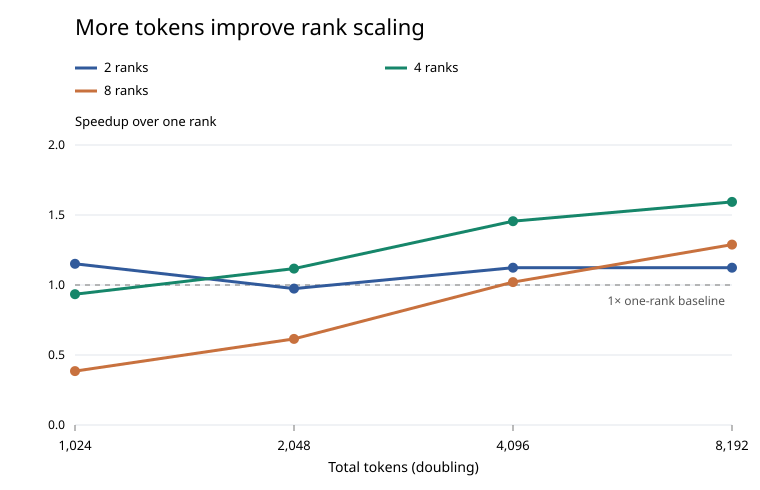

# Scaling Results (on CPU)

How do training step time, parameter storage, and communication overhead change as we split the MoE across more ranks? These CPU jobs use float64, learned top-2 routing, Adam at learning rate 0.001, and one CPU thread per worker/rank. Each job ran 25 steps: 5 warmup and 20 measured. The step time is measured as the duration of the slowest rank.

## How to read the figures

Each point represents the median of the 20 measured steps. **Speedup means one-rank step time divided by multi-rank step time using the same data and model configuration.**

## 1. More data per-training step makes parallelism more effective

This plot holds the eight-expert, 512-wide expert MLP fixed. The two-rank line ranges from **0.97× to 1.15×**. At 4-rank, the speedup rises from **0.93× at 1,024 tokens** to **1.59× at 8,192 tokens**. At 8-rank, it rises from **0.39× to 1.29×** over the same range, but remains below the four-rank line. 

## 2. Wider experts improve rank scaling

This plot fixes **16 experts, 16,384 total tokens, top-2 routing, token dimension 32, and one MoE block**. Each line represents one width for the expert MLP. Using rank-8 speedup reaches **1.96×**, **2.14×**, and **2.50×** at widths 1,024, 2,048, and 4,096. At width 4,096, the step time falls from **1470.7 to 588.8 ms**.

## 3. Sharding reduces model and optimizer storage per rank

With 16 experts at width 4,096, measured model parameters fall from **32.5 MiB on one rank** to **4.1 MiB per rank on eight ranks**. Adam state falls from **65.0 to 8.2 MiB per rank**. Together, they fall from **97.5 to 12.2 MiB per rank**. Each rank retains its own copy of the projection and router layers. Experts are divided and owned among different ranks. Adam state is calculated from two moment tensors and one step scalar per parameter tensor.

## Supporting views

### Increasing total work with ranks

This is a **fixed-local-batch** comparison: 2,048 tokens per rank, so total tokens rise from 4,096 to 16,384 as ranks rise from two to eight. For the width-4,096 model, throughput grows from **14,763 to 27,827 tokens/s**, while step time grows from **277.5 to 588.8 ms**. This is different from the fixed-global-batch speedup in Figure 2. The saved grid has no one-rank, 2,048-token point for this particular comparison.

### Additional experiments

- The [small-expert plot](rank-trends.svg) and [larger-expert plot](larger/rank-trends.svg) show absolute latency as ranks change at fixed total tokens.
- The [width-versus-speedup plot](width-speedup.svg) shows how batch size and expert width affect eight-rank speedup. Each width also has its own rank and data trend plots in `extended/`, `width-2048/`, and `width-4096/`.
- The [one-versus-two-block plot](block-trends.svg) shows the depth check at 16,384 tokens and width 1,024. Eight-rank speedup is **1.96× with one block** and **1.73× with two**. A second block adds another routing and communication stage, so this is a separate model-depth question.

## Interpretation and limits

The width-4,096, eight-rank, 16,384-token job averages **28,635 remote token-expert assignments** per measured step. Its logical forward activation payload is **14.0 MiB**, and its backward activation payload is the same. These count tensor elements, not physical network traffic or time spent in collectives. At this configuration, the most-loaded expert receives **2.63×** the average assignment count. We have not separately timed communication and expert computation, so the exact sources of the eight-rank plateau remain unresolved. These single-host CPU results do not establish GPU speedup.

## Reproduce and inspect

Run `python experiments/scaling.py` from the repository root. It reproduces all **65 jobs** and regenerates the plots, summaries, and this report. The job grids and their derived `summary.json` files are in this directory (width 64), `larger/` (width 512), `extended/` (16 experts, width 1,024), `width-2048/`, `width-4096/`, and `two-blocks/`. Each `ranks{R}-tokens{N}.json` contains per-rank configuration, loss, timing, routing counts, and parameter storage; its companion `.environment.json` records the runtime and host details.
