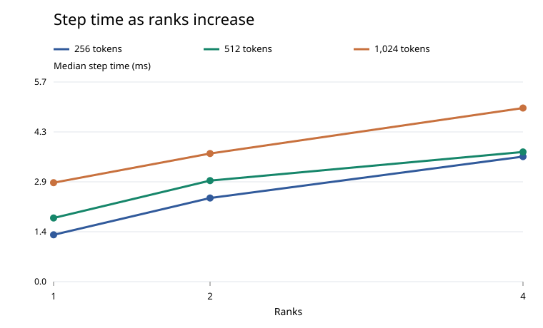

# CPU scaling results

## Question and method

How do rank count, parameter storage, communication, and step time change when the same eight-expert MoE is split across ranks? These one-block CPU/Gloo jobs use float64, learned top-2 routing, Adam at learning rate 0.001, and one CPU thread per worker. Each job ran 25 steps: 5 warmup and 20 measured. A barrier starts each timed step, and its duration is the slowest rank's time. Startup, logging, and correctness comparisons are outside the timed step.

The experiment grid crosses **1, 2, and 4 ranks** with **256, 512, and 1,024 total tokens**. This lets one graph vary ranks at a fixed total batch and the other vary batch size at a fixed rank count. The original 256-token fixed-total comparison and 256-tokens-per-rank diagonal remain available. Expert count, top-2 routing, and model dimensions stay fixed.

## Measurements

| Ranks | Total tokens | Tokens/rank | Model KiB/rank | Median ms | p95 ms | Tokens/s at median | Expert imbalance |
|---:|---:|---:|---:|---:|---:|---:|---:|
| 1 | 256 | 256 | 272.3 | 1.341 | 1.355 | 190,855 | 1.36 |
| 2 | 256 | 128 | 141.3 | 2.393 | 2.550 | 106,962 | 1.36 |
| 4 | 256 | 64 | 75.8 | 3.578 | 3.826 | 71,548 | 1.36 |
| 1 | 512 | 512 | 272.3 | 1.822 | 1.902 | 281,036 | 1.45 |
| 2 | 512 | 256 | 141.3 | 2.892 | 2.997 | 177,059 | 1.45 |
| 4 | 512 | 128 | 75.8 | 3.711 | 5.632 | 137,985 | 1.45 |
| 1 | 1,024 | 1,024 | 272.3 | 2.831 | 2.877 | 361,728 | 1.49 |
| 2 | 1,024 | 512 | 141.3 | 3.666 | 3.809 | 279,328 | 1.49 |
| 4 | 1,024 | 256 | 75.8 | 4.967 | 6.393 | 206,144 | 1.49 |

For fixed total work, model storage falls from **272.3 to 75.8 KiB per rank**, while median step time rises from **1.341 to 3.578 ms**. Expert weights are sharded; the shared projection and router still occupy 10.3 KiB on every rank. This small CPU workload pays more for communication and coordination than it gains from dividing expert computation.

For fixed local work, total throughput rises from **190,855 to 206,144 tokens/s** as total batch size grows. The median step also becomes longer: **1.341 to 4.967 ms**. This describes larger total work, not a fixed-batch speedup.

### Trends by rank and data size

Each point is a separate run's median step time. Lines in the first graph hold total tokens constant while ranks change; lines in the second hold ranks constant while total tokens change.

The original bar chart gives a compact view of the 256-token fixed-total comparison, the 256-tokens-per-rank diagonal, and parameter storage:

## Communication and interpretation

The 4-rank, 256-token job averages 375.1 remote token-expert assignments per measured step. The corresponding logical payload is 192,077 bytes in the forward activation phase and the same amount in backward, plus 3,097 bytes of routing metadata. Across all jobs, the expert imbalance ratio ranges from 1.36 to 1.49; this is the most-loaded expert's average assignment count divided by the mean.

The payload estimates count tensor elements: for `R` remote assignments, dimension `d`, element size `b`, and `W` ranks, either activation phase moves `2Rdb` bytes (dispatch and return), while expert IDs and count exchange add `8R + 8W(W-1)` bytes. They are not physical network measurements. Parameter bytes exclude gradients, Adam state, activations, and process overhead. Twenty measured steps describe this local run; they do not establish tail latency or GPU performance.

## Files

- [summary.json](summary.json): one derived metrics row for each of the nine jobs.
- [rank-trends.svg](rank-trends.svg): median latency against ranks at three fixed total token counts.
- [data-trends.svg](data-trends.svg): median latency against total tokens at three fixed rank counts.
- [scaling.svg](scaling.svg): the original fixed-total, fixed-local, and storage bar chart.
- `ranks{R}-tokens{N}.json`: per-rank configuration, loss, timing, routing counts, and parameter storage.
- `ranks{R}-tokens{N}.environment.json`: Python, PyTorch, host, dtype, and backend details for each job.
