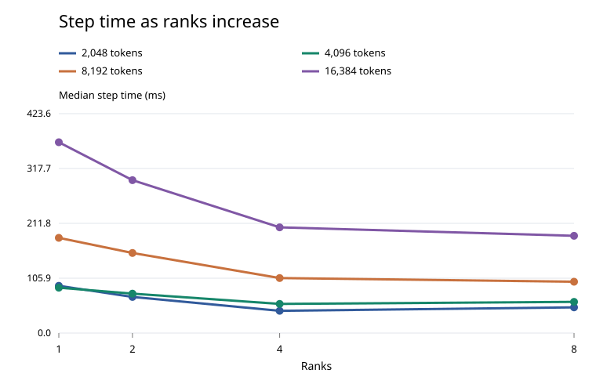
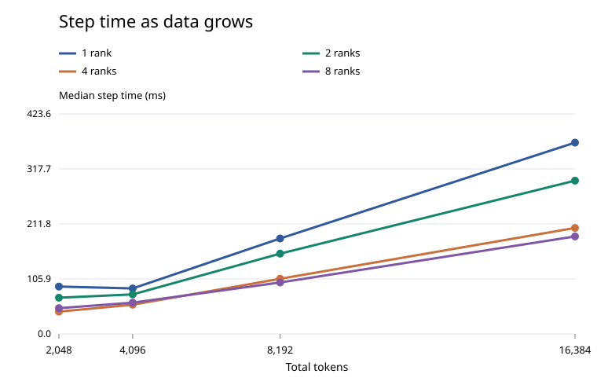
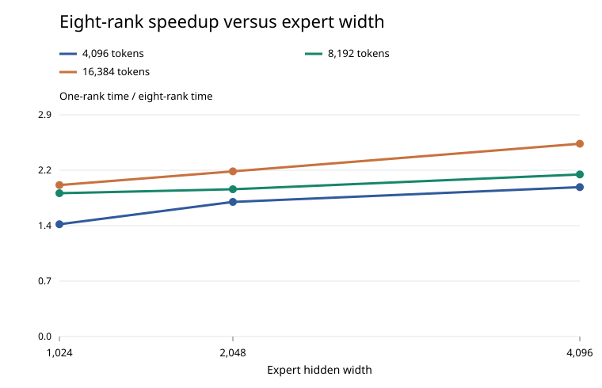
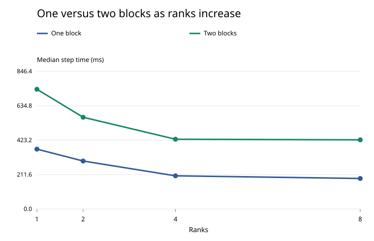

# CPU scaling results

## Question and method

How do rank count, parameter storage, communication, and step time change when an MoE is split across ranks? These CPU/Gloo jobs use float64, learned top-2 routing, Adam at learning rate 0.001, and one CPU thread per worker. Each job ran 25 steps: 5 warmup and 20 measured. A barrier starts each timed step, and its duration is the slowest rank's time. Startup, logging, and correctness comparisons are outside the timed step.

We run five one-block sweeps. The first two use eight experts and hidden widths **64** and **512** across 1, 2, and 4 ranks. The other three use **16 experts**, hidden widths **1,024, 2,048, and 4,096**, and 1, 2, 4, and 8 ranks. All use top-2 routing and token dimension 32. Within each sweep, model size is fixed as ranks and total tokens change. A follow-up compares one and two blocks at the largest 16-expert batch.

## Small expert: communication dominates

| Ranks | Total tokens | Tokens/rank | Model KiB/rank | Median ms | p95 ms | Tokens/s at median | Expert imbalance |
|---:|---:|---:|---:|---:|---:|---:|---:|
| 1 | 256 | 256 | 272.3 | 1.345 | 1.368 | 190,314 | 1.36 |
| 2 | 256 | 128 | 141.3 | 2.501 | 2.616 | 102,345 | 1.36 |
| 4 | 256 | 64 | 75.8 | 3.668 | 5.446 | 69,791 | 1.36 |
| 1 | 512 | 512 | 272.3 | 1.869 | 2.095 | 273,998 | 1.45 |
| 2 | 512 | 256 | 141.3 | 2.912 | 3.106 | 175,810 | 1.45 |
| 4 | 512 | 128 | 75.8 | 3.851 | 5.487 | 132,957 | 1.45 |
| 1 | 1,024 | 1,024 | 272.3 | 2.870 | 3.156 | 356,779 | 1.49 |
| 2 | 1,024 | 512 | 141.3 | 3.760 | 3.993 | 272,357 | 1.49 |
| 4 | 1,024 | 256 | 75.8 | 6.405 | 7.252 | 159,877 | 1.49 |

For fixed total work, model storage falls from **272.3 to 75.8 KiB per rank**, while median step time rises from **1.345 to 3.668 ms**. Expert weights are sharded; the shared projection and router still occupy 10.3 KiB on every rank. This small CPU workload pays more for communication and coordination than it gains from dividing expert computation.

For fixed local work, total throughput is **190,314, 175,810, and 159,877 tokens/s** at 1, 2, and 4 ranks. Median step time grows from **1.345 to 6.405 ms**. This describes larger total work, not a fixed-batch speedup.

### Trends by rank and data size

Each point is a separate run's median step time. Lines in the first graph hold total tokens constant while ranks change; lines in the second hold ranks constant while total tokens change.

The original bar chart gives a compact view of the 256-token fixed-total comparison, the 256-tokens-per-rank diagonal, and parameter storage:

## Larger expert: more compute per exchanged token

With hidden width 512, the following table shows median step latency for the same global token count across ranks. The last column is `1-rank time / 4-rank time`; values above 1 indicate a measured speedup.

| Total tokens | 1 rank ms | 2 ranks ms | 4 ranks ms | 4-rank speedup |
|---:|---:|---:|---:|---:|
| 1,024 | 10.664 | 9.259 | 11.412 | 0.93× |
| 2,048 | 20.811 | 21.362 | 18.627 | 1.12× |
| 4,096 | 46.250 | 41.167 | 31.771 | 1.46× |
| 8,192 | 92.235 | 82.109 | 57.892 | 1.59× |

At 8,192 tokens, the 4-rank run stores 530.8 KiB of model parameters per rank, versus 2092.3 KiB on one rank. The trend graphs show where the larger expert workload begins to overcome dispatch and synchronization overhead:

The 1,024-token row is shared across the two model-size sweeps; only expert hidden width changes there. The remaining rows show the effect of increasing data within each model. These single-host CPU measurements are descriptive and are not a GPU speedup claim.

At a fixed **1,024 tokens per rank**, the larger workload processes 1,024, 2,048, and 4,096 total tokens at 1, 2, and 4 ranks. Median cluster throughput is 96,026, 95,872, and 128,921 tokens/s, respectively. This is a separate fixed-local-work comparison; the table above holds total work fixed.

## Extended sweep: 16 experts, 1,024 hidden units

The model has the same 16 experts at every rank count. At eight ranks, each worker owns two experts. Each row holds global token count fixed; the final column is 1-rank time divided by 8-rank time.

| Total tokens | 1 rank ms | 2 ranks ms | 4 ranks ms | 8 ranks ms | 8-rank speedup |
|---:|---:|---:|---:|---:|---:|
| 4,096 | 87.637 | 76.119 | 56.242 | 60.235 | 1.45× |
| 8,192 | 183.847 | 154.531 | 106.246 | 99.016 | 1.86× |
| 16,384 | 368.308 | 295.087 | 204.053 | 187.694 | 1.96× |

At 16,384 tokens, model parameter storage is 8336.4 KiB on one rank and 1052.9 KiB per rank on eight ranks. As with the other sweeps, these are single-host CPU timings and do not measure GPU performance.

Four ranks beat eight at 4,096 tokens; at 16,384 tokens, eight ranks are only 1.09× faster than four. The 16-expert run has an expert-load imbalance ratio of 2.85 at the largest batch. Communication, synchronization, and uneven expert work can all limit eight-rank scaling; this experiment does not isolate their individual contributions.

### Does widening experts improve scaling?

These runs hold expert count (16), token dimension (32), top-k (2), and block count (1) fixed. Only expert hidden width changes across the three groups. The activation row exchanged by each all-to-all stays 32 float64 values. All four rank counts were measured; the final column compares eight ranks with one at the same width and total tokens.

| Expert width | Total tokens | 1 rank ms | 2 ranks ms | 4 ranks ms | 8 ranks ms | 8-rank speedup |
|---:|---:|---:|---:|---:|---:|---:|
| 1,024 | 4,096 | 87.6 | 76.1 | 56.2 | 60.2 | 1.45× |
| 1,024 | 8,192 | 183.8 | 154.5 | 106.2 | 99.0 | 1.86× |
| 1,024 | 16,384 | 368.3 | 295.1 | 204.1 | 187.7 | 1.96× |
| 2,048 | 4,096 | 172.7 | 145.4 | 104.5 | 99.0 | 1.74× |
| 2,048 | 8,192 | 340.6 | 282.2 | 196.8 | 178.4 | 1.91× |
| 2,048 | 16,384 | 712.6 | 547.3 | 394.2 | 333.0 | 2.14× |
| 4,096 | 4,096 | 346.0 | 277.5 | 196.4 | 178.7 | 1.94× |
| 4,096 | 8,192 | 708.3 | 553.0 | 391.6 | 337.4 | 2.10× |
| 4,096 | 16,384 | 1470.7 | 1086.3 | 727.6 | 588.8 | 2.50× |

At 16,384 tokens, eight-rank speedup is 1.96×, 2.14×, and 2.50× at widths 1,024, 2,048, and 4,096. Wider experts increase parameter and intermediate-activation storage as well as compute. These runs quantify the local CPU tradeoff; they do not imply the same ratios on GPUs.

### Does adding a block change scaling?

Holding 16 experts, hidden width 1,024, and 16,384 total tokens fixed, we compare one and two MoE blocks. Each block has its own projection, router, experts, and dispatch/return collectives. The last column is two-block time divided by one-block time at the same rank count.

| Ranks | One block ms | Two blocks ms | Time ratio |
|---:|---:|---:|---:|
| 1 | 368.308 | 736.015 | 2.00× |
| 2 | 295.087 | 564.217 | 1.91× |
| 4 | 204.053 | 428.948 | 2.10× |
| 8 | 187.694 | 425.387 | 2.27× |

The one-block 8-rank speedup is 1.96×, versus 1.73× with two blocks. Adding depth changes the model and doubles the number of routing/communication stages; it does not isolate expert-parallel efficiency as cleanly as changing ranks at fixed depth.

## Communication and interpretation

The 4-rank, 256-token job averages 375.1 remote token-expert assignments per measured step. The corresponding logical payload is 192,077 bytes in the forward activation phase and the same amount in backward, plus 3,097 bytes of routing metadata. Across the one-block sweeps, the expert imbalance ratio ranges from 1.36 to 2.85; this is the most-loaded expert's average assignment count divided by the mean.

The payload estimates count tensor elements: for `R` remote assignments summed across `B` blocks, dimension `d`, element size `b`, and `W` ranks, either activation phase moves `2Rdb` bytes (dispatch and return), while expert IDs and count exchange add `8R + 8BW(W-1)` bytes. They are not physical network measurements. Parameter bytes exclude gradients, Adam state, activations, and process overhead. Twenty measured steps describe this local run; they do not establish tail latency or GPU performance.

## Files

- [summary.json](summary.json): one derived metrics row for each of the nine small-expert jobs.
- [larger/summary.json](larger/summary.json): one derived metrics row for each of the twelve larger-expert jobs.
- [extended/summary.json](extended/summary.json): one derived metrics row for each of the twelve 16-expert jobs.
- [width-2048/summary.json](width-2048/summary.json) and [width-4096/summary.json](width-4096/summary.json): the two wider-expert sweeps, twelve jobs each.
- [two-blocks/summary.json](two-blocks/summary.json): four jobs isolating block count at 16,384 tokens.
- [rank-trends.svg](rank-trends.svg): median latency against ranks at three fixed total token counts.
- [data-trends.svg](data-trends.svg): median latency against total tokens at three fixed rank counts.
- [scaling.svg](scaling.svg): the original fixed-total, fixed-local, and storage bar chart.
- [larger/rank-trends.svg](larger/rank-trends.svg) and [larger/data-trends.svg](larger/data-trends.svg): larger-expert latency trends.
- [extended/rank-trends.svg](extended/rank-trends.svg) and [extended/data-trends.svg](extended/data-trends.svg): 16-expert latency trends.
- [width-speedup.svg](width-speedup.svg): eight-rank speedup as expert width changes at three fixed token counts.
- `width-2048/` and `width-4096/` also contain rank and data trend plots for each width.
- [block-trends.svg](block-trends.svg): one versus two blocks at fixed model width and total tokens.
- `ranks{R}-tokens{N}.json` (in the sweep directories): per-rank configuration, loss, timing, routing counts, and parameter storage.
- `ranks{R}-tokens{N}.environment.json` (in the sweep directories): Python, PyTorch, host, dtype, and backend details for each job.
