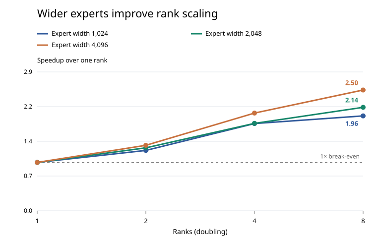
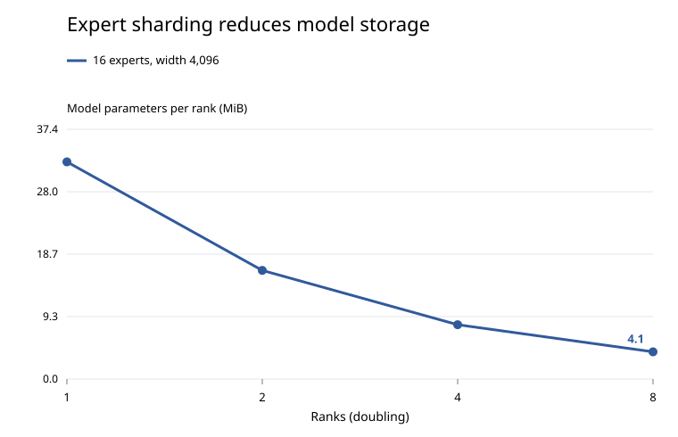
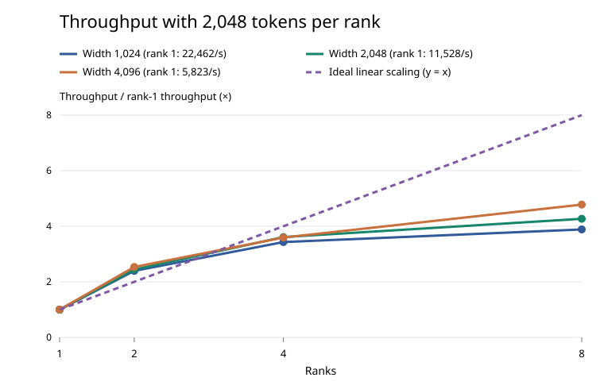

# Scaling Results (on CPU)

How do training step time, parameter storage, and communication overhead change as we split the MoE across more ranks? These CPU jobs use float64, learned top-2 routing, Adam at learning rate 0.001, and one CPU thread per worker/rank. Each job ran 25 steps: 5 warmup and 20 measured. The step time is measured as the duration of the slowest rank.

## How to read the figures

Each point represents the median of the 20 measured steps. **Speedup means one-rank step time divided by multi-rank step time using the same data and model configuration.**

## 1. More data per-training step makes parallelism more effective

This plot holds the eight-expert, 512-wide expert MLP fixed. The two-rank line ranges from **0.97× to 1.15×**. At 4-rank, the speedup rises from **0.93× at 1,024 tokens** to **1.59× at 8,192 tokens**. At 8-rank, it rises from **0.39× to 1.29×** over the same range, but remains below the four-rank line.

## 2. Wider experts improve rank scaling

This plot fixes **16 experts, 16,384 total tokens, top-2 routing, token dimension 32, and one MoE block**. Each line represents one width for the expert MLP. Using rank-8 speedup reaches **1.96×**, **2.14×**, and **2.50×** at widths 1,024, 2,048, and 4,096. At width 4,096, the step time falls from **1470.7 to 588.8 ms**.

## 3. Sharding reduces model and optimizer storage per rank

With 16 experts at width 4,096, measured model parameters fall from **32.5 MiB on one rank** to **4.1 MiB per rank on eight ranks**. Adam state falls from **65.0 to 8.2 MiB per rank**. Together, they fall from **97.5 to 12.2 MiB per rank**. Each rank retains its own copy of the projection and router layers. Experts are divided and owned among different ranks. Adam state is calculated from two moment tensors and one step scalar per parameter tensor.

## 4. Training throughput scaling from adding more ranks

This is a **fixed-local-batch** comparison with 16 experts and one MoE block. Each rank processes 2,048 tokens, so total tokens rise from 2,048 to 16,384 as ranks rise from one to eight. Each line shows measured cluster throughput in tokens/s for one expert width. One-rank throughput is **22,462**, **11,528**, and **5,823 tokens/s** for expert widths 1,024, 2,048, and 4,096. For width 4,096, throughput grows to **27,827 tokens/s** at eight ranks. This is different from the fixed-global-batch speedup in Figure 2.

## Scaling Interpretation and Analysis

We scale expert parallelism for both speed and capacity. With the global batch fixed at 16,384 tokens, the width-4,096 model takes 1,470.7 ms on one rank and 588.8 ms on eight ranks, a 2.50× speedup. Splitting the experts also reduces model parameters and Adam state from 97.5 MiB on one rank to 12.2 MiB per rank on eight ranks. That storage benefit could let a larger system hold more experts than one device can accommodate, even when step-time speedup is imperfect.

The speedup is below the ideal 8× because adding ranks divides expert computation but does not remove the communication required by each step. Top-2 routing creates 32,768 token-expert assignments in this job, and 28,635 go to a different rank. The activation send and receive operations account for 14.0 MiB of logical forward payload, with another 14.0 MiB in the reverse gradient exchanges. Ranks must also synchronize the shared layer's gradients, such as the projection and router layer gradients. As each rank gets less computation, the communication overhead becomes harder to amortize. That is consistent with the smaller 1.24× improvement from four to eight ranks.

Uneven routing is another possible constraint. The busiest expert receives 2.63× the average assignment count. Since the step ends when the slowest rank finishes, a rank with substantially more expert work can leave others waiting. An expert-level imbalance does not by itself prove the same degree of rank-level imbalance since each rank owns two experts, and their loads may offset each other. 

The fixed-local-batch results show a different reason to scale: processing more data. Holding the batch at 2,048 tokens per rank increases total tokens from 2,048 to 16,384 between one and eight ranks. For width 4,096, measured cluster throughput rises from 5,823 to 27,827 tokens/s. The expert layer width sweep also suggests that the amount of expert work matters; at a fixed 16,384-token batch, eight-rank speedup increases from 1.96× at width 1,024 to 2.50× at width 4,096. Wider expert MLPs do more computation, which helps amortize the communication time.

## Reproduce and inspect

Run `python experiments/scaling.py` from the repository root. It reproduces all **77 jobs** and regenerates the plots, summaries, and this report. The job grids and their derived `summary.json` files are in this directory (width 64), `larger/` (width 512), `extended/` (16 experts, width 1,024), `width-2048/`, `width-4096/`, and `two-blocks/`. Each `ranks{R}-tokens{N}.json` contains per-rank configuration, loss, timing, routing counts, and parameter storage; its companion `.environment.json` records the runtime and host details.
